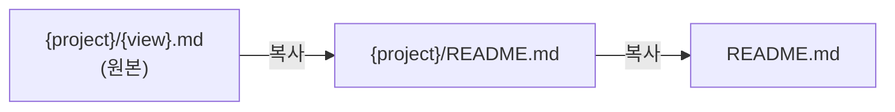
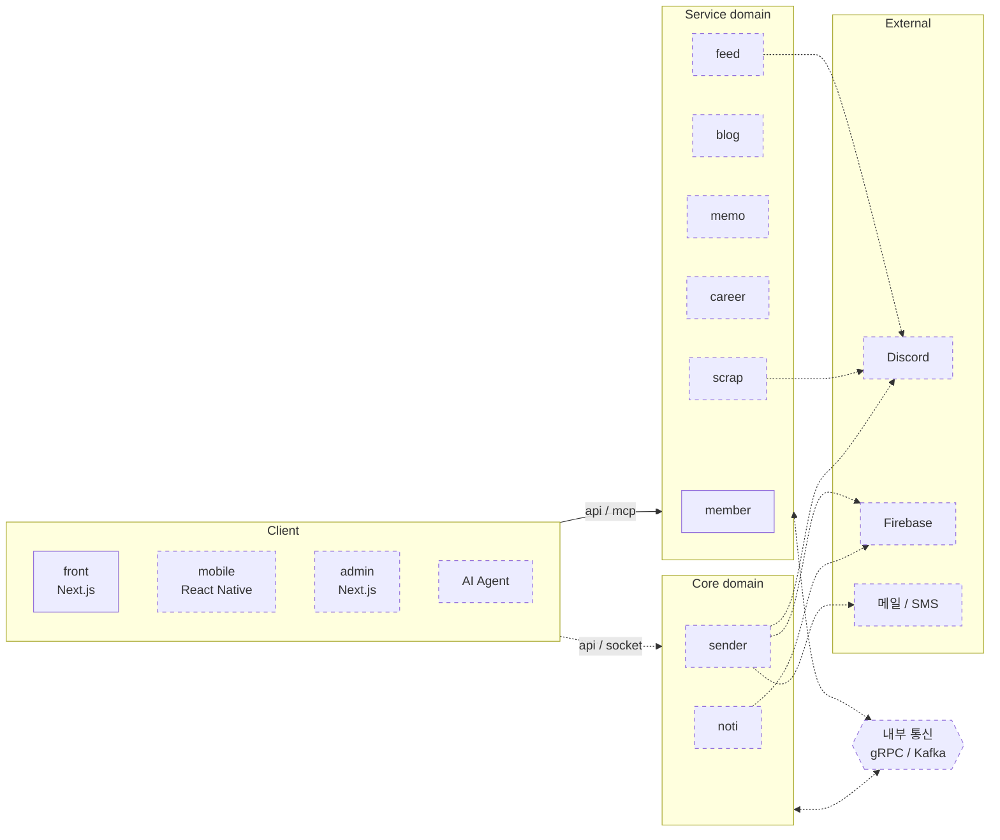
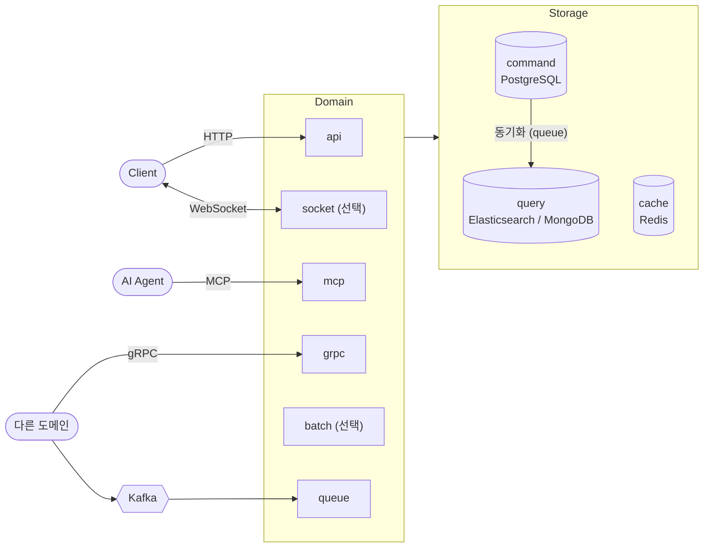
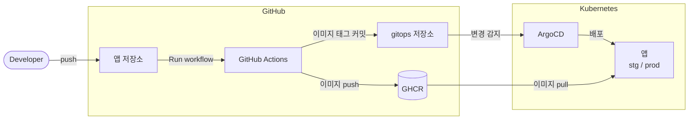
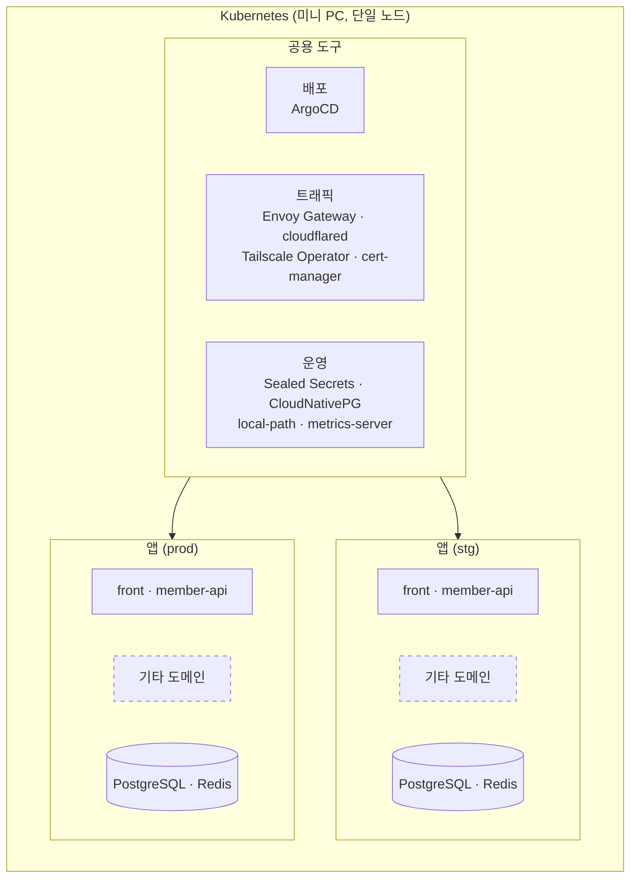
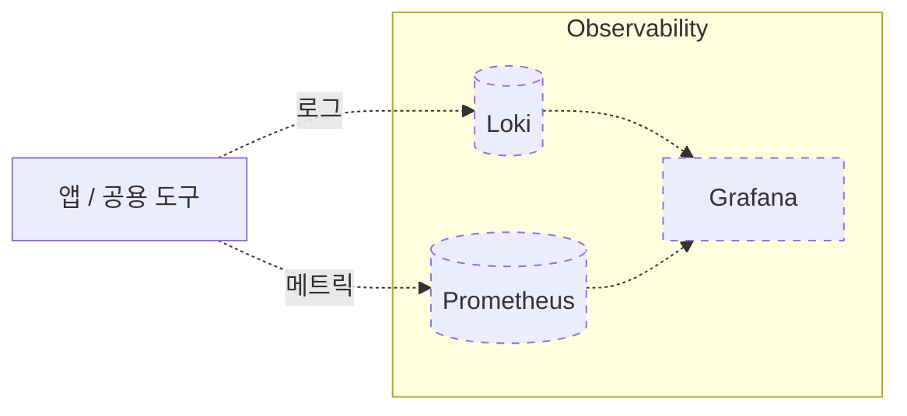
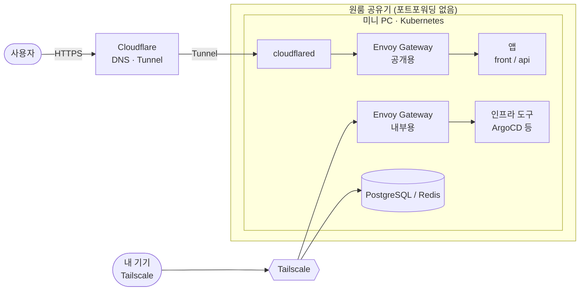

# choimory-architectures

- [개요](#개요)
- [디렉토리 구조](#디렉토리-구조)
- [다이어그램 관리 방식](#다이어그램-관리-방식)
- [choimory-dev](#choimory-dev)
  - [service](#service)
  - [devops](#devops)
  - [network](#network)

---

# 개요

- 다양한 프로젝트의 아키텍처를 [Mermaid](https://mermaid.js.org)로 작성하여 관리하는 리포지토리
- 별도 빌드나 이미지 생성 없이 GitHub에서 Markdown 그대로 다이어그램이 렌더링됨

---

# 디렉토리 구조

```
choimory-architectures/
├── README.md               # 전체 프로젝트 목차 및 프로젝트별 다이어그램
└── {project}/
    ├── README.md           # 프로젝트 개요 및 프로젝트 다이어그램 모음
    └── {view}.md           # 관점별 상세 다이어그램 (원본)
```

- 관점별 문서(`{view}.md`)는 고정되어 있지 않으며, 프로젝트 구성에 맞게 적절히 분리함 (예: service, devops, network)

---

# 다이어그램 관리 방식



- 다이어그램 수정은 항상 관점별 문서(원본)에서 하고, 프로젝트 README → 루트 README 순서로 복사하여 동기화함
- 복사본에는 `<!-- source: {project}/{view}.md -->` 주석과 원본 링크를 함께 작성함
- 계획 중인 구성 요소는 점선으로 표시함

---

# choimory-dev

- 토이 프로젝트 choimory-dev의 전체 구성
- 상세: [choimory-dev/README.md](./choimory-dev/README.md)

## service

### 전체 구성

<!-- source: choimory-dev/service.md -->


- 상세: [service.md](./choimory-dev/service.md)

### 도메인 공통 구조

<!-- source: choimory-dev/service.md -->


- 상세: [service.md](./choimory-dev/service.md)

## devops

### 배포 흐름

<!-- source: choimory-dev/devops.md -->


- 상세: [devops.md](./choimory-dev/devops.md)

### 클러스터 구성

<!-- source: choimory-dev/devops.md -->


- 상세: [devops.md](./choimory-dev/devops.md)

### 로그·메트릭

<!-- source: choimory-dev/devops.md -->


- 상세: [devops.md](./choimory-dev/devops.md)

## network

### 접속 경로

<!-- source: choimory-dev/network.md -->


- 상세: [network.md](./choimory-dev/network.md)

