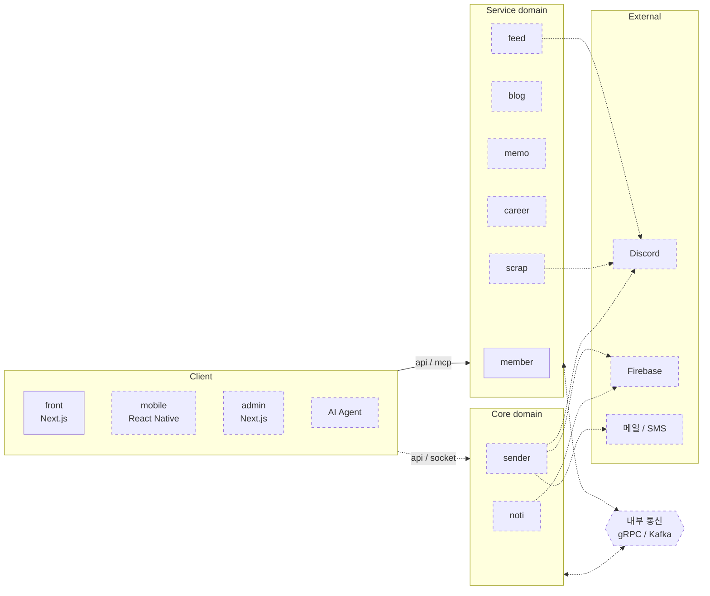
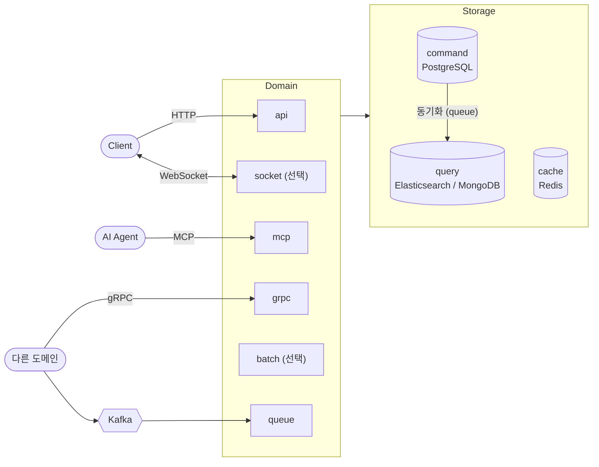
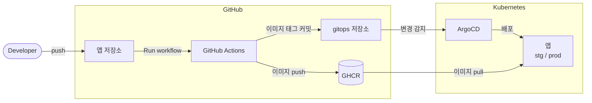
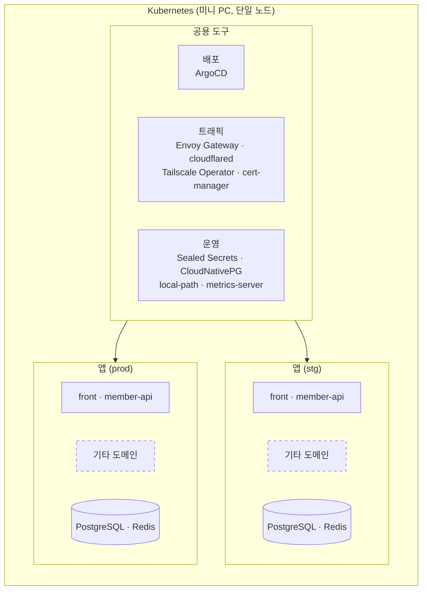
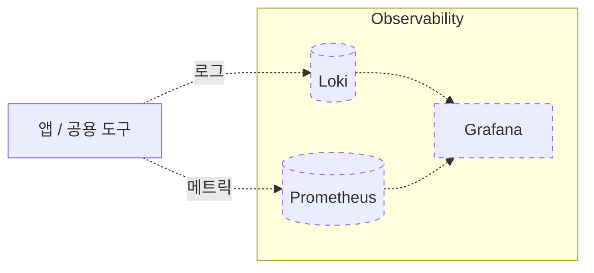
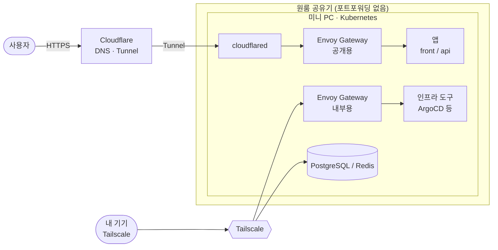

# choimory-dev

- [개요](#개요)
- [service](#service)
  - [전체 구성](#전체-구성)
  - [도메인 공통 구조](#도메인-공통-구조)
- [devops](#devops)
  - [배포 흐름](#배포-흐름)
  - [클러스터 구성](#클러스터-구성)
  - [로그·메트릭](#로그메트릭)
- [network](#network)
  - [접속 경로](#접속-경로)

---

# 개요

- 토이 프로젝트 choimory-dev의 전체 구성
- 클라이언트(front, mobile, admin)와 서비스 도메인(member, blog, memo, career, feed, scrap), 코어 도메인(sender, noti)으로 구성
- 모든 도메인은 api / grpc / queue / mcp 모듈을 기본으로 가지며, gRPC(동기)와 Kafka(비동기)로 서로 호출
- 미니 PC의 단일 노드 Kubernetes에 GitHub Actions + ArgoCD(GitOps)로 배포하고, Cloudflare Tunnel(공개)과 Tailscale(내부)로 접속

| 문서 | 내용 |
|---|---|
| [service.md](./service.md) | 클라이언트, 도메인 구성, 도메인 공통 구조, 도메인 목록 |
| [devops.md](./devops.md) | 배포 흐름, 클러스터 구성, 로그·메트릭 |
| [network.md](./network.md) | 공개 / 내부 접속 경로 |

> 점선: 계획 중인 구성 요소

---

# service

## 전체 구성

<!-- source: choimory-dev/service.md -->

- 상세: [service.md](./service.md)

## 도메인 공통 구조

<!-- source: choimory-dev/service.md -->

- 상세: [service.md](./service.md)

---

# devops

## 배포 흐름

<!-- source: choimory-dev/devops.md -->

- 상세: [devops.md](./devops.md)

## 클러스터 구성

<!-- source: choimory-dev/devops.md -->

- 상세: [devops.md](./devops.md)

## 로그·메트릭

<!-- source: choimory-dev/devops.md -->

- 상세: [devops.md](./devops.md)

---

# network

## 접속 경로

<!-- source: choimory-dev/network.md -->

- 상세: [network.md](./network.md)

