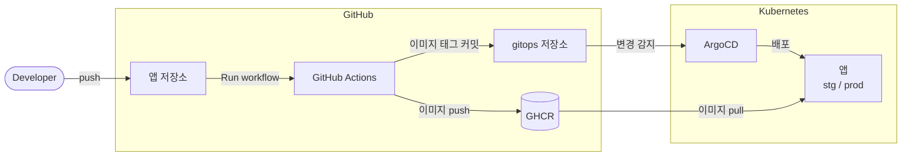
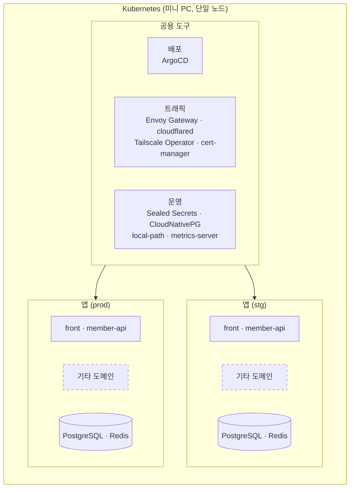
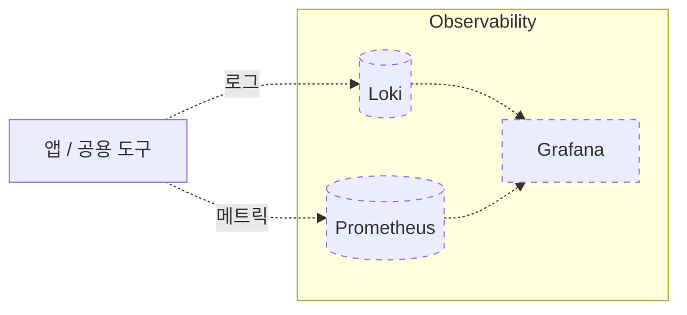

# choimory-dev devops

- [배포 흐름](#배포-흐름)
- [클러스터 구성](#클러스터-구성)
- [로그·메트릭](#로그메트릭)

> 점선: 계획 중인 구성 요소

---

# 배포 흐름

- CI: 앱 저장소에서 GitHub Actions를 실행하여 테스트, 이미지 빌드 후 GHCR에 push
- CD: Actions가 gitops 저장소의 이미지 태그를 커밋하면, 클러스터 안의 ArgoCD가 변경을 감지하여 배포 (pull 방식, 인바운드 불필요)

---

# 클러스터 구성

- 공용 도구는 여러 프로젝트가 함께 사용하며, 프로젝트 앱은 환경(stg, prod)별로 분리
- PostgreSQL, Redis는 앱과 같은 환경 안에 프로젝트별·환경별로 하나씩 둠

---

# 로그·메트릭

- 로그는 Loki, 메트릭은 Prometheus로 수집하고 Grafana로 시각화
