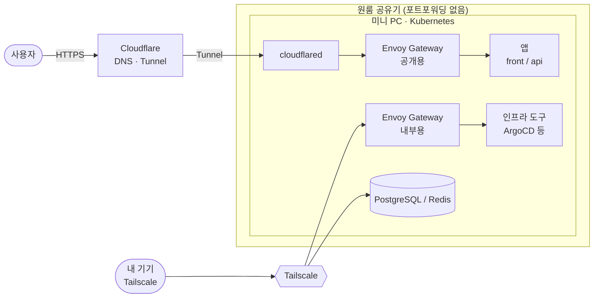

# choimory-dev network

- [접속 경로](#접속-경로)

> 점선: 계획 중인 구성 요소

---

# 접속 경로

| 경로 | 대상 | 공개 범위 |
|---|---|---|
| Cloudflare → Tunnel → cloudflared → 공개용 Gateway | 앱 (front, api) | 인터넷 공개 |
| Tailscale → 내부용 Gateway | 인프라 도구 (ArgoCD 등) | tailnet 기기만 |
| Tailscale → DB | PostgreSQL, Redis | tailnet 기기만 |

- Cloudflare(공개)와 Tailscale(내부)은 서로 다른 경로임
- cloudflared와 Tailscale 모두 미니 PC에서 바깥으로 연결을 여는 방식이라, 공유기 포트포워딩 없이 외부에서 접속 가능
