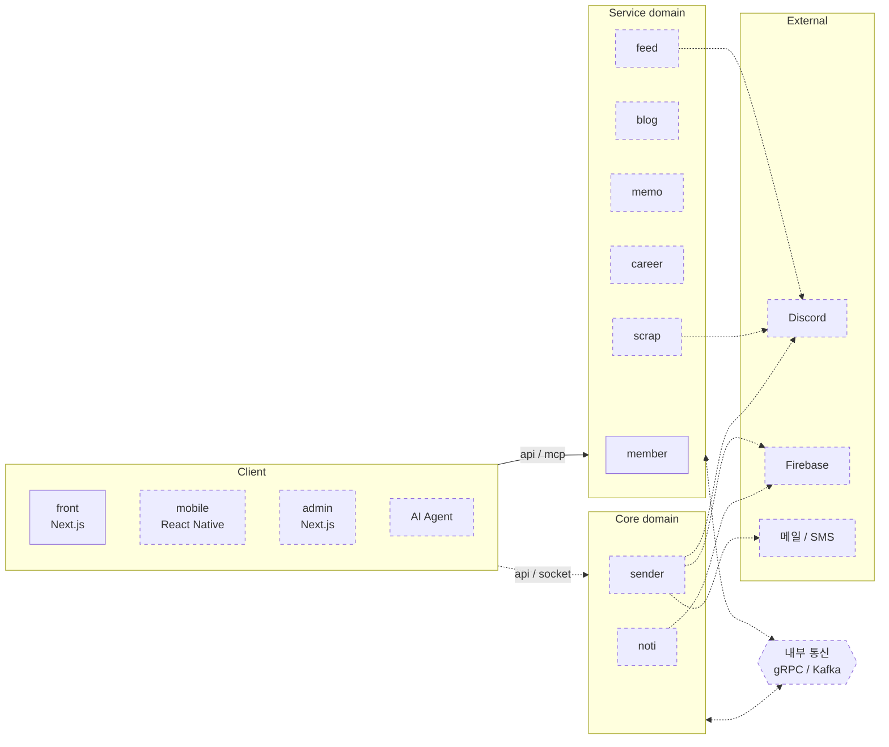
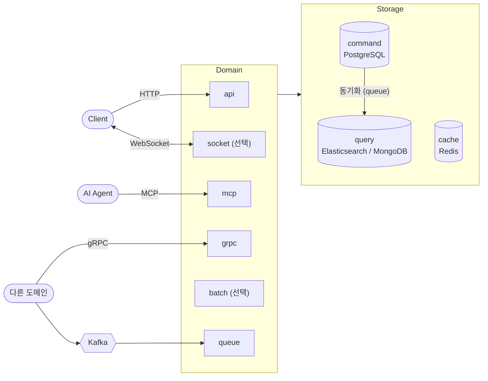

# choimory-dev service

- [전체 구성](#전체-구성)
- [도메인 공통 구조](#도메인-공통-구조)
- [도메인 목록](#도메인-목록)

> 점선: 계획 중인 구성 요소

---

# 전체 구성

- 클라이언트는 각 도메인의 `api`(HTTP), `mcp`(AI Agent), `socket`(실시간 알림)을 호출
- 모든 도메인은 필요에 따라 다른 모든 도메인을 gRPC(동기) 또는 Kafka(비동기)로 호출할 수 있음
- 서비스 도메인은 사이트 기능을 담당하고, 코어 도메인(sender, noti)은 발송·알림을 내부적으로 담당

---

# 도메인 공통 구조

| 모듈 | 역할 |
|---|---|
| api | 외부(프론트) 요청 처리 |
| grpc | 내부 동기 요청 처리 (즉시 응답 필요) |
| queue | 내부 비동기 요청 처리 (Kafka, 유실 없음), command → query DB 동기화 |
| mcp | AI Agent 요청 처리 |
| batch | 스케줄링 기반 정기 작업 (필요한 도메인만) |
| socket | 프론트와의 실시간 통신 (필요한 도메인만) |

- 모든 도메인은 `api`, `grpc`, `queue`, `mcp`를 기본으로 가지며, 필요에 따라 `batch`, `socket`을 추가함
- 저장소는 CQRS로 command / query를 분리하고, 필요한 도메인은 cache를 둠

---

# 도메인 목록

## Service domain

| 도메인 | 설명 | 추가 모듈 | 스택 | 저장소·외부 연동 |
|---|---|---|---|---|
| member | 회원 | batch | Java 21, Spring Boot | PostgreSQL, Elasticsearch, Redis |
| blog | 블로그 게시글, 댓글 | - | Kotlin, Spring Boot | PostgreSQL, Elasticsearch, Redis |
| memo | 개인 메모 | - | NestJS | PostgreSQL, MongoDB |
| career | 경력, 이력서 소개 | - | 미정 | PostgreSQL, MongoDB |
| feed | 아이템, 가격, 아티스트 앨범 모니터링 | batch | Kotlin, Ktor | PostgreSQL, Elasticsearch, Redis, Discord |
| scrap | 동영상, PDF 수집 | batch | 미정 | PostgreSQL, Elasticsearch, Discord |

## Core domain

| 도메인 | 설명 | 추가 모듈 | 스택 | 저장소·외부 연동 |
|---|---|---|---|---|
| sender | 메일, SMS, 메신저, 모바일 푸시 발송 | - | Spring WebFlux | PostgreSQL, Elasticsearch, Firebase, 메일·SMS·메신저 |
| noti | 웹페이지 알림 | socket | NestJS | PostgreSQL, Redis pub/sub, Firebase |
